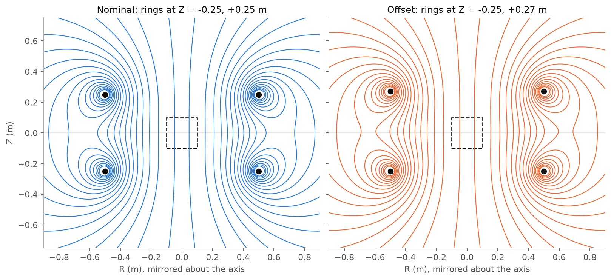
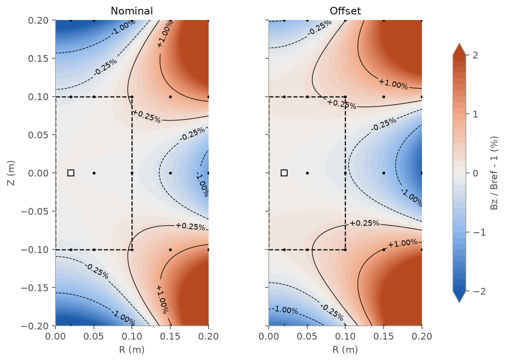
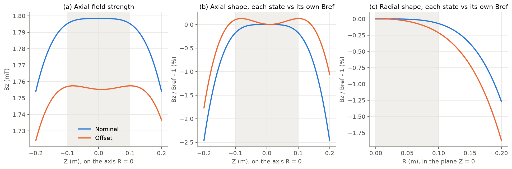
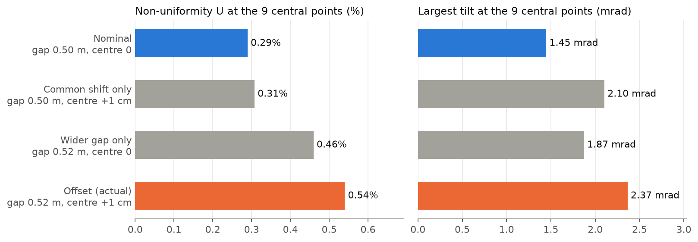

# 圆环线圈上移 2 cm 对中心区磁场的影响

## 答案

上环上移 2 cm 后，中心区的场整体减弱约 2.4%，从 1.80 mT 降到 1.76 mT；中心 9 个采样点的不均匀度从约 0.29% 增加到约 0.54%，约为原来的 1.9 倍；场方向的最大倾角从 1.45 mrad 增加到 2.37 mrad。

这主要是因为两环间距从 0.50 m 变成 0.52 m，偏离了亥姆霍兹条件：中心的平顶变成了略微下凹的形状，同时平坦区跟着两环中点上移约 1 cm。

这块场能不能用，取决于实验能容忍多大的不均匀度。你没有给出这个指标，所以本报告不作判定。如果容许值明显大于 0.54%，这次偏移在这 9 个采样点上不构成限制；如果要求接近或严于这个量级，就需要关注它。场强的下降可以通过调电流补偿，形状的变化则不能。

## 问题与理解

**你的问题。** 一对圆环线圈，用来在中间做较均匀的轴向场。上环安装时往上偏了一点，想知道影响有多大、这块场还能不能用。不考虑等离子体，线圈按细圆环算。

**我的理解。** 这是两个固定安装状态之间的真空磁场比较，不是线圈优化：

- 两环半径 0.50 m，每环实际电流 +1000 A，名义位置 Z = ±0.25 m，偏移后上环到 +0.27 m；
- “影响”用四个量衡量：中心场强、中心 9 点的不均匀度 $U$、场方向倾角 $T$、(R=0.10 m, Z=0) 处的磁通；
- 观测点固定不动，每个状态用自己的 $B_z(0.02\,{\rm m},0)$ 作参考，差值都是偏移减名义；
- 你没有给合格线，所以只说明变化，不判定可用与否。

完整口径见 [request.md](request.md)。

## 物理模型与方法

**从问题到模型。** 两环半径 $a=0.50$ m、间距 $d=0.50$ m，名义上正好是亥姆霍兹线圈，这决定了分析的思路。场的“均匀”来自 $d=a$ 时轴上场在中点的二阶导数恰好为零；上环上移破坏了这个条件。所以问题的物理核心是：偏移如何改变中心的场强和场的形状。

**模型假设。** 真空静磁场，线圈是无限细电流环，无磁性材料和等离子体。系统轴对称，因此 $B_\phi=0$，场由子午面上的 $B_r$、$B_z$ 完全描述。

**单环的场。** 轴对称场可以用通量函数 $\psi=RA_\phi$ 描述，对细环的 Biot–Savart 积分给出椭圆积分形式。半径 $a$、位于 $z_0$、电流 $I$ 的细环有

$$\psi(R,z)=\frac{\mu_0 I}{\pi}\frac{\sqrt{aR}}{k}\left[\left(1-\frac{k^2}{2}\right)K(k^2)-E(k^2)\right],\qquad k^2=\frac{4aR}{(a+R)^2+(z-z_0)^2},$$

场由 $\psi$ 的导数给出：

$$B_r=-\frac1R\frac{\partial\psi}{\partial z},\qquad B_z=\frac1R\frac{\partial\psi}{\partial R}.$$

在轴线上，这个解退化为熟悉的 $B_z=\mu_0Ia^2/\left[2\left(a^2+(z-z_0)^2\right)^{3/2}\right]$。

**两环叠加。** 真空静磁方程是线性的，所以两环的场直接相加。单环响应和电流叠加这两步可以调用 `scirel.field` 的 `circular_filament_green_response` 和 `superpose_current_green_field`；其余指标是普通的数值计算。

**为什么场形会变。** 对两环的轴上解在中点求二阶导数，得到

$$\left.\frac{d^2B_z}{dz^2}\right|_{\rm 中点}=\frac{3\mu_0Ia^2(d^2-a^2)}{(a^2+d^2/4)^{7/2}}.$$

它在 $d=a$ 时为零（亥姆霍兹条件），$d>a$ 时为正，也就是中点成为局部极小。这个公式预言：间距变大后，平顶会变成下凹。

**怎样分开两个因素。** 上环上移等于“两环一起上移 1 cm”加上“间距增大 2 cm”。我额外计算了只平移和只增大间距两个辅助工况，用来判断哪个因素起主要作用。它们只用于解释，不属于你要求的指标。

**怎样确认算得对。** 用不经过椭圆积分的方法独立核对：对 Biot–Savart 直接做角向数值积分，并与轴上解析解、亥姆霍兹解析解、$\psi$ 的导数关系和圆盘磁通积分比较。结果见附录 A。

## 结果

**核心指标。** 下表是四个量的变化，全部 25 点的结果见附录 B。

| 量 | 名义 | 偏移 | 偏移减名义 |
| --- | --- | --- | --- |
| 参考点轴向场 $B_{\rm ref}$ | 1.80 mT | 1.76 mT | -0.043 mT（-2.4%） |
| 中心 9 点不均匀度 $U$ | 0.29% | 0.54% | +0.25 个百分点 |
| 中心 9 点最大倾角 $T_{\max}$ | 1.45 mrad | 2.37 mrad | +0.92 mrad |
| (R=0.10 m, Z=0) 处圆盘磁通 $\Phi$ | 5.65×10⁻⁵ Wb | 5.51×10⁻⁵ Wb | -1.4×10⁻⁶ Wb（-2.5%） |

**整体场线几乎不变。** 从整个线圈的尺度看，两种状态的场线（$\psi$ 等值线）很难分辨，中心区的场线都接近竖直（图 1）。所以差异要到“百分之零点几”的尺度才能看到。



*图 1　子午面场线（$\psi$ 等值线）。黑点是线圈截面，虚线框是中心统计区。*

**中心平顶变成略微下凹。** 图 2 显示中心区 $B_z$ 相对各自参考场的偏差：名义状态上下对称，偏移状态的高低区都向上移动，对称性被破坏。



*图 2　$B_z/B_{\rm ref}-1$ 分布。方块是参考点，小黑点是 25 个观测点，虚线框是中心统计区。等值线按连续场绘制仅用于观察，指标只统计 9 个采样点。*

轴上和径向的分布（图 3）更直接：名义状态是平顶，偏移状态整体下移，轴上出现一个约 0.12% 的浅凹，凹点在中点 Z≈+1 cm 附近，正如二阶导数公式所预言。径向上场随 R 下降得也更快：在 (R=0.10 m, Z=0)，相对参考场的偏差从 -0.072% 变为 -0.21%。



*图 3　(a) 轴上 $B_z$；(b) 轴上相对各自 $B_{\rm ref}$ 的偏差；(c) 中平面上相对各自 $B_{\rm ref}$ 的偏差。灰色带是中心统计范围。*

**不均匀度主要来自间距变大。** 图 4 把两个因素分开：只平移时 $U$ 为 0.31%，几乎不变；只增大间距时 $U$ 为 0.46%，占了增量的大部分。倾角则不同，平移（2.10 mrad）和增大间距（1.87 mrad）都有明显作用。



*图 4　四种配置在中心 9 点的 $U$ 和 $T_{\max}$。灰色是只用于解释的辅助工况。*

## 讨论

**场强下降可以用简单的物理解释。** 只有上环动了，它对中心场贡献一半；单环在轴上的场随距离的相对变化率是 $-3z_0\delta/(a^2+z_0^2)$。代入 $z_0=0.25$ m、$\delta=0.02$ m，一半贡献给出 -2.4%，与计算的 -2.4% 基本一致。

**幅值和形状的影响性质不同。** 场与电流成正比，所以电流再增加约 2.5% 就能把参考场拉回原值，而 $U$ 和 $T$ 不随电流改变。形状变化来自几何，只能靠调整线圈位置来改变。这是模型的直接推论，本次没有计算调整方案。

**平移的影响部分取决于统计区是否跟着动。** 观测点固定时，只平移也会让倾角明显增大，因为中心统计区不再相对平坦区居中。这一项是几何上的错位：如果实验区能随场的中心移动约 1 cm，这部分影响可以减小；由间距引起的部分则不会消失。

**结论的适用范围。**

- $U$ 和 $T_{\max}$ 只针对 9 个采样点，图 2 表明连续场在点之间还有变化，它们不是整个区域的上下界。
- 只计算了上移正好 2 cm 这一种情况。你说“好像偏了一点”，如果实际偏移量不同，要重新计算。
- 模型不含线圈的有限截面、匝间分布、横向偏心、倾斜和环境磁性材料。真实装配误差通常不止轴向一种。
- 结果是数值模型的预言，没有和实测场比较。

## 结论

上环上移 2 cm 使中心场减弱约 2.4%，9 个采样点的不均匀度从约 0.29% 增加到约 0.54%，最大倾角从 1.45 mrad 增加到 2.37 mrad。物理原因是两环间距偏离亥姆霍兹条件，中心的平顶变成浅凹，并且平坦区上移约 1 cm。

场强的损失可以用电流补偿，形状的变化不能。这块场是否够用，请用上述不均匀度和倾角对照实验要求判断；如果能给出容许值，或用测磁确认实际偏移量，结论可以更具体。

## 附录

### 附录 A：验证结果

共 29 项检查，未通过 0 项。容差在看结果前写定，是数值一致性容差，不是工程合格线。完整记录见 [data/checks.json](data/checks.json)。

| 检查 | 对照对象 | 结果 |
| --- | --- | --- |
| 25 点的 $B_r$、$B_z$、$\psi$ | 直接对 Biot–Savart 做角向数值积分，最大差 1.1e-18 T | 通过 |
| 轴上 $B_z$，$\psi=0$，$B_r=0$，$+\phi$ 电流给出 $B_z>0$ | 轴上解析解和符号约定 | 通过 |
| 名义中心场 | 亥姆霍兹解析解 1.798 mT | 通过 |
| 轴上二阶导数公式 | 轴上解的有限差分 | 通过 |
| $B_r$、$B_z$ 与 $\psi$ 的导数关系 | 对 $\psi$ 做中心差分 | 通过 |
| $\Phi=2\pi\psi$ | 对 $B_z$ 做圆盘面积分 | 通过 |
| 名义工况 $B_r$ 在 Z=0 为零，$B_r$ 奇对称，$B_z$、$\psi$ 偶对称 | 对称性（未修改输出） | 通过 |
| 两环叠加 | 逐项相加，容差取舍入误差界 | 通过 |

**和外部平台先前结果的对比。** 外部 agent 平台先前的一次运行保留过一项叠加检查的失败：(R=0.2 m, Z=0) 的 $B_r$ 约为 $1.1\times10^{-20}$ T，超过当时写定的绝对容差 $10^{-20}$ T。这个点上两环贡献相互抵消，差值来自浮点舍入。这里把容差改为由两项之和估算的舍入误差界，这是容差口径的改变，特此说明。核心数值与那次运行一致。

**未运行的内容：** 靠近导线的奇异极限、连续区域的误差界、与实测数据的比较。

### 附录 B：全部 25 个观测点

保留 4 位有效数字，完整精度见 [data/points.csv](data/points.csv)。绝对值低于数值舍入水平（场和倾角 $10^{-15}$，$\psi$ $10^{-18}$）的量写作 0。

**名义状态**

| R (m) | Z (m) | $B_r$ (T) | $B_z$ (T) | 幅值 (T) | $\psi$ (Wb/rad) | $T$ (rad) |
| --- | --- | --- | --- | --- | --- | --- |
| 0.02 | -0.2 | -8.019e-06 | 0.001755 | 0.001755 | 3.509e-07 | 0.004569 |
| 0.02 | -0.1 | -1.209e-06 | 0.001796 | 0.001796 | 3.591e-07 | 0.0006732 |
| 0.02 | 0 | 0 | 0.001798 | 0.001798 | 3.597e-07 | 0 |
| 0.02 | 0.1 | 1.209e-06 | 0.001796 | 0.001796 | 3.591e-07 | 0.0006732 |
| 0.02 | 0.2 | 8.019e-06 | 0.001755 | 0.001755 | 3.509e-07 | 0.004569 |
| 0.05 | -0.2 | -1.975e-05 | 0.00176 | 0.00176 | 2.196e-06 | 0.01122 |
| 0.05 | -0.1 | -2.603e-06 | 0.001797 | 0.001797 | 2.245e-06 | 0.001448 |
| 0.05 | 0 | 0 | 0.001798 | 0.001798 | 2.248e-06 | 0 |
| 0.05 | 0.1 | 2.603e-06 | 0.001797 | 0.001797 | 2.245e-06 | 0.001448 |
| 0.05 | 0.2 | 1.975e-05 | 0.00176 | 0.00176 | 2.196e-06 | 0.01122 |
| 0.1 | -0.2 | -3.72e-05 | 0.001779 | 0.00178 | 8.833e-06 | 0.0209 |
| 0.1 | -0.1 | -2.036e-06 | 0.001804 | 0.001804 | 8.997e-06 | 0.001129 |
| 0.1 | 0 | 0 | 0.001797 | 0.001797 | 8.99e-06 | 0 |
| 0.1 | 0.1 | 2.036e-06 | 0.001804 | 0.001804 | 8.997e-06 | 0.001129 |
| 0.1 | 0.2 | 3.72e-05 | 0.001779 | 0.00178 | 8.833e-06 | 0.0209 |
| 0.15 | -0.2 | -4.928e-05 | 0.001814 | 0.001815 | 2.006e-05 | 0.02715 |
| 0.15 | -0.1 | 5.828e-06 | 0.001812 | 0.001812 | 2.03e-05 | 0.003215 |
| 0.15 | 0 | 0 | 0.001792 | 0.001792 | 2.021e-05 | 0 |
| 0.15 | 0.1 | -5.828e-06 | 0.001812 | 0.001812 | 2.03e-05 | 0.003215 |
| 0.15 | 0.2 | 4.928e-05 | 0.001814 | 0.001815 | 2.006e-05 | 0.02715 |
| 0.2 | -0.2 | -5.085e-05 | 0.001871 | 0.001871 | 3.618e-05 | 0.02718 |
| 0.2 | -0.1 | 2.727e-05 | 0.001821 | 0.001821 | 3.62e-05 | 0.01497 |
| 0.2 | 0 | 0 | 0.001775 | 0.001775 | 3.582e-05 | 0 |
| 0.2 | 0.1 | -2.727e-05 | 0.001821 | 0.001821 | 3.62e-05 | 0.01497 |
| 0.2 | 0.2 | 5.085e-05 | 0.001871 | 0.001871 | 3.618e-05 | 0.02718 |

**偏移状态**

| R (m) | Z (m) | $B_r$ (T) | $B_z$ (T) | 幅值 (T) | $\psi$ (Wb/rad) | $T$ (rad) |
| --- | --- | --- | --- | --- | --- | --- |
| 0.02 | -0.2 | -7.177e-06 | 0.001725 | 0.001725 | 3.449e-07 | 0.00416 |
| 0.02 | -0.1 | -4.563e-07 | 0.001757 | 0.001757 | 3.514e-07 | 0.0002597 |
| 0.02 | 0 | 1.092e-07 | 0.001755 | 0.001755 | 3.51e-07 | 6.22e-05 |
| 0.02 | 0.1 | -5.652e-08 | 0.001758 | 0.001758 | 3.515e-07 | 3.216e-05 |
| 0.02 | 0.2 | 5.311e-06 | 0.001738 | 0.001738 | 3.474e-07 | 0.003057 |
| 0.05 | -0.2 | -1.763e-05 | 0.00173 | 0.00173 | 2.159e-06 | 0.01019 |
| 0.05 | -0.1 | -6.849e-07 | 0.001759 | 0.001759 | 2.197e-06 | 0.0003894 |
| 0.05 | 0 | 3.264e-07 | 0.001755 | 0.001755 | 2.194e-06 | 0.0001861 |
| 0.05 | 0.1 | -5.497e-07 | 0.001759 | 0.001759 | 2.197e-06 | 0.0003126 |
| 0.05 | 0.2 | 1.288e-05 | 0.001742 | 0.001742 | 2.174e-06 | 0.007395 |
| 0.1 | -0.2 | -3.287e-05 | 0.00175 | 0.00175 | 8.684e-06 | 0.01879 |
| 0.1 | -0.1 | 2.062e-06 | 0.001765 | 0.001765 | 8.804e-06 | 0.001168 |
| 0.1 | 0 | 1.053e-06 | 0.001751 | 0.001751 | 8.768e-06 | 0.0006011 |
| 0.1 | 0.1 | -4.167e-06 | 0.001762 | 0.001762 | 8.798e-06 | 0.002365 |
| 0.1 | 0.2 | 2.279e-05 | 0.001759 | 0.001759 | 8.739e-06 | 0.01296 |
| 0.15 | -0.2 | -4.256e-05 | 0.001785 | 0.001786 | 1.973e-05 | 0.02384 |
| 0.15 | -0.1 | 1.263e-05 | 0.001773 | 0.001773 | 1.986e-05 | 0.007123 |
| 0.15 | 0 | 2.672e-06 | 0.001743 | 0.001743 | 1.969e-05 | 0.001533 |
| 0.15 | 0.1 | -1.473e-05 | 0.001764 | 0.001765 | 1.982e-05 | 0.008349 |
| 0.15 | 0.2 | 2.578e-05 | 0.00179 | 0.00179 | 1.983e-05 | 0.0144 |
| 0.2 | -0.2 | -4.155e-05 | 0.001842 | 0.001842 | 3.559e-05 | 0.02256 |
| 0.2 | -0.1 | 3.753e-05 | 0.001781 | 0.001781 | 3.541e-05 | 0.02107 |
| 0.2 | 0 | 5.86e-06 | 0.001722 | 0.001722 | 3.486e-05 | 0.003402 |
| 0.2 | 0.1 | -3.788e-05 | 0.001764 | 0.001764 | 3.526e-05 | 0.02147 |
| 0.2 | 0.2 | 1.548e-05 | 0.001839 | 0.001839 | 3.57e-05 | 0.008416 |

**偏移减名义**

| R (m) | Z (m) | $B_r$ (T) | $B_z$ (T) | 幅值 (T) | $\psi$ (Wb/rad) | $T$ (rad) |
| --- | --- | --- | --- | --- | --- | --- |
| 0.02 | -0.2 | 8.419e-07 | -2.994e-05 | -2.995e-05 | -5.989e-09 | -0.0004087 |
| 0.02 | -0.1 | 7.525e-07 | -3.824e-05 | -3.824e-05 | -7.645e-09 | -0.0004135 |
| 0.02 | 0 | 1.092e-07 | -4.319e-05 | -4.319e-05 | -8.628e-09 | 6.22e-05 |
| 0.02 | 0.1 | -1.265e-06 | -3.795e-05 | -3.795e-05 | -7.574e-09 | -0.0006411 |
| 0.02 | 0.2 | -2.708e-06 | -1.754e-05 | -1.755e-05 | -3.499e-09 | -0.001512 |
| 0.05 | -0.2 | 2.118e-06 | -2.99e-05 | -2.993e-05 | -3.741e-08 | -0.00103 |
| 0.05 | -0.1 | 1.918e-06 | -3.84e-05 | -3.84e-05 | -4.788e-08 | -0.001059 |
| 0.05 | 0 | 3.264e-07 | -4.373e-05 | -4.373e-05 | -5.426e-08 | 0.0001861 |
| 0.05 | 0.1 | -3.152e-06 | -3.881e-05 | -3.881e-05 | -4.787e-08 | -0.001136 |
| 0.05 | 0.2 | -6.862e-06 | -1.808e-05 | -1.814e-05 | -2.22e-08 | -0.003822 |
| 0.1 | -0.2 | 4.332e-06 | -2.974e-05 | -2.982e-05 | -1.493e-07 | -0.00212 |
| 0.1 | -0.1 | 4.098e-06 | -3.892e-05 | -3.892e-05 | -1.929e-07 | 3.921e-05 |
| 0.1 | 0 | 1.053e-06 | -4.565e-05 | -4.565e-05 | -2.219e-07 | 0.0006011 |
| 0.1 | 0.1 | -6.203e-06 | -4.202e-05 | -4.202e-05 | -1.994e-07 | 0.001236 |
| 0.1 | 0.2 | -1.441e-05 | -2.015e-05 | -2.039e-05 | -9.38e-08 | -0.00795 |
| 0.15 | -0.2 | 6.716e-06 | -2.936e-05 | -2.952e-05 | -3.34e-07 | -0.003313 |
| 0.15 | -0.1 | 6.801e-06 | -3.961e-05 | -3.957e-05 | -4.384e-07 | 0.003908 |
| 0.15 | 0 | 2.672e-06 | -4.883e-05 | -4.883e-05 | -5.172e-07 | 0.001533 |
| 0.15 | 0.1 | -8.904e-06 | -4.794e-05 | -4.789e-05 | -4.801e-07 | 0.005134 |
| 0.15 | 0.2 | -2.35e-05 | -2.425e-05 | -2.473e-05 | -2.321e-07 | -0.01275 |
| 0.2 | -0.2 | 9.302e-06 | -2.861e-05 | -2.884e-05 | -5.878e-07 | -0.004625 |
| 0.2 | -0.1 | 1.026e-05 | -4.018e-05 | -3.999e-05 | -7.878e-07 | 0.006097 |
| 0.2 | 0 | 5.86e-06 | -5.311e-05 | -5.31e-05 | -9.634e-07 | 0.003402 |
| 0.2 | 0.1 | -1.06e-05 | -5.747e-05 | -5.726e-05 | -9.402e-07 | 0.006498 |
| 0.2 | 0.2 | -3.538e-05 | -3.172e-05 | -3.234e-05 | -4.752e-07 | -0.01876 |

极值位置：名义 $U$ 在 (R=0.1 m, Z=-0.1 m)、(R=0.1 m, Z=+0.1 m)，偏移 $U$ 在 (R=0.1 m, Z=-0.1 m)；名义 $T_{\max}$ 在 (R=0.05 m, Z=-0.1 m)、(R=0.05 m, Z=+0.1 m)，偏移 $T_{\max}$ 在 (R=0.1 m, Z=+0.1 m)。参考点 (R=0.02 m, Z=0)。指定点 $\psi$：名义 8.99e-06 Wb/rad，偏移 8.768e-06 Wb/rad，差 -2.219e-07 Wb/rad。$\psi$ 是每弧度的通量函数，$\Phi=2\pi\psi$ 才是圆盘总磁通。

### 附录 C：复现

```sh
PYTHONPATH=src python examples/coil-offset/solve.py
PYTHONPATH=src python examples/coil-offset/make_figures.py
python examples/coil-offset/make_report.py
```

依赖版本见仓库 `pyproject.toml`，绘图需要 `report` 依赖组里的 matplotlib。
