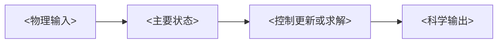
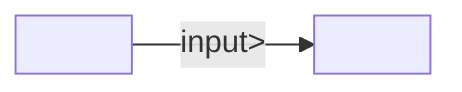

# <项目名称> 程序框架图

## 主要程序目标

<物理或科学目标、建模系统、主要状态及预期输出。>

## Level 0 物理关系 Mermaid

## 标准算例

| Field | Value |
|---|---|
| 算例 | <算例名称和来源> |
| 源程序运行时 | <项目专用可移植运行时标识> |
| 资产运行时 | <可复用资产运行时标识> |
| 预期输出 | <命名输出和 oracle> |

## 主要状态与输出

| 标识符 | 含义 | 形状/轴 | 单位 | 生产者 | 消费者 |
|---|---|---|---|---|---|
| `<state_id>` | <含义> | <形状和轴顺序> | <单位或证据未声明> | `<node_id>` | `<node_id>` |

## 框架节点台账

| 节点 ID | 框架角色 | 科学关系 | 源码锚点 | 输入 | 输出 | 拆解决策 |
|---|---|---|---|---|---|---|
| `<node_id>` | <source/state/solver/diagnostic> | <stable mapping> | `<path:line-line::symbol>` | `<ids>` | `<ids>` | <operator/task_graph/support/reject/gap> |

## PFM 到任务图投影

| 主要 PFM 节点 | 任务图包 | 覆盖范围 | 相关 PFM 依赖 | 审核状态 |
|---|---|---|---|---|
| `N1` — <name> | `task_graphs/<name>` | `full` / `slice` / `support` | `N1` or `none` | <mapped/validated/gap> |

## 框架边台账

| 边 ID | 生产者.输出 | 消费者.输入 | 依赖原因 | 合同状态 | 证据 |
|---|---|---|---|---|---|
| `<edge_id>` | `<node.output>` | `<node.input>` | <why order/binding is required> | <closed/gap kind> | `<path:line-line>` |

## 生成的 Mermaid

## 拆解决策

| 源码区域/流程 | 决策 | 框架切片 | 原因 |
|---|---|---|---|
| `<path:line-line::symbol>` | <operator/task_graph/support/reject> | `<node_id(s)>` | <scientific and dependency rationale> |

## 基准 fixture 计划

| 声明 | 算例/输入 | Oracle | 捕获方法 | 容差 | 证据位置 |
|---|---|---|---|---|---|
| <claim> | <case> | <source/direct/formula/invariant> | <method> | <metric and threshold> | <external evidence path> |

## 完整性声明

<列出未映射源码族、未闭合框架边或状态/oracle 边界。只有穷尽审查后，才能写“在声明范围内未发现”。>
